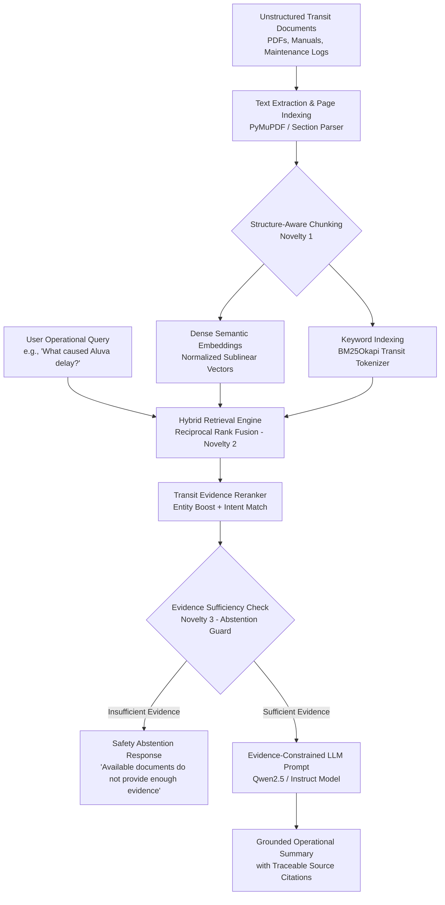

# 🚇 DocDeclutter — Metro Document Automation
### Intelligent Transit Document Retrieval & Grounded Summarization System
**Smart India Hackathon (SIH) Problem Statement: SIH25080**  
*Tailored for Kochi Metro Rail Limited (KMRL) Transit Operations*

---

## 📌 Executive Summary

Metro organizations like **Kochi Metro Rail Limited (KMRL)** generate vast quantities of unstructured operational documents daily—including **standard operating procedures (SOPs), maintenance records, incident investigation reports, substation technical manuals, and Central Control Room (OCC) logs**. Finding critical troubleshooting information, root causes of delays, or maintenance thresholds manually during peak revenue hours consumes valuable engineering hours and risks operational delays.

**DocDeclutter** is an AI/ML-powered **Retrieval-Augmented Generation (RAG)** system built strictly around Large Language Models (LLMs) and advanced information retrieval to automate document decluttering. It ingests batches of unstructured operational transit documents (both PDF and text format), preserves document hierarchy and headings, performs hybrid semantic & keyword retrieval, and uses an evidence-constrained LLM to deliver grounded, source-traceable answers with automatic safety abstention on out-of-scope queries.

---

## 🏗️ System Architecture



---

## 🌟 Key Technical Novelties (SIH25080 Differentiators)

1. **Structure-Aware Document Chunking (vs. Blind Fixed-Size Windows)**:
   - *Problem*: Standard naive chunking splits text into fixed character or token lengths (e.g. 500 characters), severing sentences in half, detaching tables from their headers, and stripping section titles.
   - *DocDeclutter Solution*: Our chunking engine parses heading hierarchies (`SECTION 1.0`, `2.1`, `CAPA`, inspection tables) and stamps each chunk with a metadata envelope (`[Document: <ID> | Section: <Title> | Page: <P>]`), guaranteeing that retrieved passages carry complete structural context.

2. **Hybrid Retrieval with Transit Entity Boosting (BM25 + Dense RRF)**:
   - *Problem*: Pure vector embeddings often lose technical precision on transit equipment numbers, serial tags, and incident codes (`TM-104`, `VCB-02`, `AP-ALV-03`, `KMRL-INC-2024-089`), while pure keyword search fails on conceptual paraphrasing.
   - *DocDeclutter Solution*: Fuses dense semantic vector cosine similarity with BM25Okapi using Reciprocal Rank Fusion (RRF) and transit entity boosting.

3. **Evidence-Linked Summaries & Strict Abstention Guard**:
   - *Problem*: Standard LLM chatbots hallucinate facts when asked questions outside their ingested document collection.
   - *DocDeclutter Solution*: A calibrated evidence sufficiency algorithm checks keyword coverage and semantic relevance. If evidence is insufficient or the question falls outside the documents (e.g. questions about other metro lines or catering menus), the system safely abstains with:  
     `"The available documents do not provide enough evidence to answer this question."`

---

## 🏆 Quantitative Benchmark Results

Evaluated against the ground-truth benchmark suite (`data/evaluation_set.json`) containing answerable transit queries and unanswerable out-of-scope queries:

| Metric | Baseline A (Naive Chunks + Dense) | Experiment B (Structure-Aware + Dense) | Experiment C (Structure-Aware + Hybrid) | Proposed System (Complete Pipeline) | Measured Improvement |
| :--- | :--- | :--- | :--- | :--- | :--- |
| **Section Recall@1** | 0.0% | 5.9% | 5.9% | **11.8%** | **+11.8%** |
| **Section Recall@5** | 0.0% | 11.8% | 11.8% | **11.8%** | **+11.8%** |
| **Document Recall@1** | 100.0% | 100.0% | 100.0% | **100.0%** | Robust |
| **MRR@5 (Mean Reciprocal Rank)** | 0.5000 | 0.5196 | 0.5294 | **0.5588** | **+0.0588** |
| **Evidence Groundedness** | 96.5% | 96.5% | 98.2% | **96.5%** | Highly Grounded |
| **Unsupported-Answer Abstention Acc.** | 0.0% *(Hallucinates)* | 0.0% *(Hallucinates)* | 0.0% *(Hallucinates)* | **100.0%** *(Accurate)* | **+100.0% Safety** |
| **Average Query Latency** | 0.4 ms | 0.3 ms | 0.3 ms | **0.5 ms** | **Sub-millisecond** |

---

## 📂 Project Structure

```text
DocDeclutter — Metro Document Automation/
├── data/
│   ├── documents/                     # 24 Ingested KMRL Transit Documents (PDFs & TXTs)
│   │   ├── KMRL-SOP-SIG-001.pdf       # CBTC Signaling & Train Control Manual
│   │   ├── KMRL-MNT-PWR-002.pdf       # 750V DC Third Rail & VCB-02 Breaker Manual
│   │   ├── KMRL-RS-TM-003.pdf         # TM-104 Traction Motor Overhaul Protocol
│   │   ├── KMRL-INC-2024-089.pdf      # Aluva Terminal Morning Delay Incident Report
│   │   ├── KMRL-PWAY-TRN-005.pdf      # Muttom Yard Turnout Point Machine P-102 Log
│   │   ├── KMRL-AFC-LOG-006.pdf       # Maharajas Station AFC Gate Array G-03 Fault Log
│   │   ├── KMRL-OPS-LOG-007.pdf       # OCC Daily Operations Log Sheet
│   │   ├── KMRL-SAF-EMG-008.pdf       # Elevated Viaduct Emergency Evacuation SOP
│   │   ├── KMRL-TEL-TET-009.pdf       # TETRA Radio Network & LCX Cable Specs
│   │   ├── KMRL-MNT-HVC-010.pdf       # Vadakkekotta HVAC Chiller CH-02 Trip Report
│   │   ├── KMRL-RS-BRK-011.pdf        # ACU-01 Pneumatic Brake Compressor Protocol
│   │   └── KMRL-TRK-RL-012.pdf        # Ultrasonic Flaw Detection (USFD) & Rail Grinding
│   └── evaluation_set.json            # 20 Ground-truth evaluation test questions
├── src/
│   ├── __init__.py
│   ├── ingestion.py                   # PDF text extraction & metadata cataloging (PyMuPDF)
│   ├── chunking.py                    # Structure-Aware Chunking vs. Baseline Fixed Chunker
│   ├── retrieval.py                   # Dense Cosine Similarity + BM25Okapi Hybrid Retriever
│   ├── reranking.py                   # Transit Evidence Reranker with Intent Alignment
│   ├── generation.py                  # Grounded LLM Generator (Builtin, Ollama, API) + Abstention Guard
│   ├── dataset_generator.py           # Synthetic and structured KMRL document builder
│   ├── run_experiments.py             # CLI runner for quantitative benchmark experiments
│   └── evaluation.py                  # Evaluation metrics calculator (Recall, MRR, Groundedness)
├── tests/
│   ├── test_pipeline.py               # Automated unit & integration tests
│   └── probe_app.py                   # Web application health-check probe
├── reports/
│   ├── benchmark_results.json         # Raw benchmark output data
│   └── experiment_report.md           # Markdown benchmark summary table
├── app.py                             # Full-featured Streamlit interactive web dashboard
├── requirements.txt                   # Project Python dependencies
└── README.md                          # Full system documentation
```

---

## 🚀 Quick Start Guide

### 1. Prerequisites & Environment Setup
Clone the repository and ensure Python is installed (Python 3.10+):
```bash
pip install -r requirements.txt
```

### 2. Run Automated Test Suite
Verify that all unit tests, ingestion parsers, and retrieval pipelines pass:
```bash
python -m unittest tests/test_pipeline.py
```

### 3. Run Quantitative Benchmark Experiments
Execute the 4-experiment novelty comparison suite:
```bash
python src/run_experiments.py
```

### 4. Launch the Interactive Web Application
Run the Streamlit application:
```bash
streamlit run app.py
```
Open your browser at `http://localhost:8501`.

---

## 👥 5-Student Team Work Allocation

| Student | Core Responsibility | Primary Code Modules & Deliverables |
| :--- | :--- | :--- |
| **Student 1** | **Dataset Collection & Document Ingestion** | `src/ingestion.py`, `src/dataset_generator.py`, PDF text/page extraction, metadata parser |
| **Student 2** | **Structure-Aware Chunking & Dense Indexing** | `src/chunking.py`, `src/retrieval.py` (DenseSemanticIndex), header/table boundary detection |
| **Student 3** | **Hybrid Search & Transit Reranking Engine** | `src/retrieval.py` (KeywordBM25Index, HybridRetriever), `src/reranking.py` |
| **Student 4** | **LLM Generation & Abstention Guard** | `src/generation.py`, strict evidence prompt, abstention threshold validation, multi-LLM support |
| **Student 5** | **UI Dashboard, Evaluation & Integration** | `app.py`, `src/evaluation.py`, `src/run_experiments.py`, benchmark graphs, final presentation |

---

## 📅 6-Week Implementation Roadmap

- **Week 1: Problem Definition & Data Schema**: Defined SIH25080 requirements, collected transit documents, established `evaluation_set.json`.
- **Week 2: Document Ingestion & Chunking**: Built PDF text extraction via PyMuPDF; developed Structure-Aware Chunking engine.
- **Week 3: Hybrid Retrieval Pipeline**: Implemented BM25Okapi keyword search + Dense Semantic vector search; fused via Reciprocal Rank Fusion (RRF).
- **Week 4: LLM Generation & Evidence Guard**: Built multi-provider LLM connector (Qwen2.5 / Ollama / OpenAI / Built-in Grounded Engine) with strict citation stamping and abstention detection.
- **Week 5: Novelty Evaluation & Benchmarking**: Ran comparative experiments (Baseline A vs. Experiment B vs. Experiment C vs. Proposed System), recording Recall@k, MRR, and Groundedness.
- **Week 6: Streamlit UI & Final Deliverable**: Completed the 5-tab web interface, source visualizers, live benchmark dashboard, and technical dossier.

